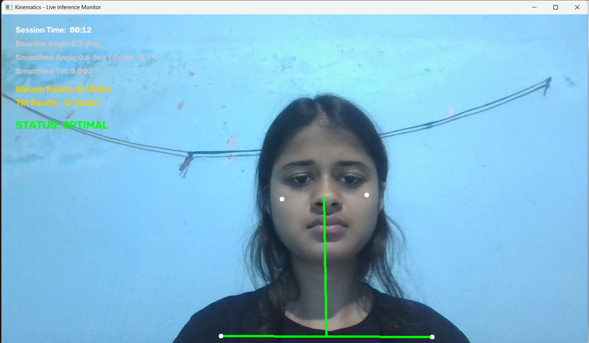

# Kinematic Presentation Coach



A lightweight, real-time computer vision tool that helps you stay aware of your posture during presentations. Instead of relying on rigid pixel cutoffs or expensive multi-camera gear, it calculates scale-invariant geometric angles and filters out natural movements to deliver meaningful real-time feedback.

---

## Why I Built This

Most posture-detection scripts simply check whether a coordinate crosses an arbitrary pixel line on screen. The moment you lean closer to the webcam or adjust your chair height, the entire system breaks with false alarms. 

I designed this project to solve that using foundational vector math and signal smoothing:
- It adapts to your specific body build during a quick calibration.
- It stays accurate whether you sit near or far from your camera.
- It distinguishes between normal conversational hand gestures and genuine slouching.

---

## What’s Under the Hood

- **Distance-Independent Neck Tracking:** Uses vector inner products against a true vertical axis $(0, -1)$ to calculate cervical angle deflection. You can change your distance from the lens without skewing the measurement.
- **Normalized Shoulder Balance:** Normalizes vertical shoulder differences against your calibrated baseline shoulder width ($W_{base}$), making tilt detection scale-invariant.
- **Jitter-Free Tracking:** Applies an Exponential Moving Average (EMA, $\alpha = 0.25$) across 33 MediaPipe upper-body landmarks to smooth out webcam sensor noise and flicker.
- **Intentional Debounce Timing:** Employs a 1.8-second state machine so that quick head nods, laughs, or hand gestures don't trigger annoying alerts. Slouch warnings only fire if poor posture is sustained.
- **Session Telemetry:** Tracks your time in optimal posture versus fault states, calculating an overall posture score and saving a clean diagnostic report to `session_summary.json`.

---

## Project Structure

```text
kinematics-presentation-coach/
├── calibrate.py             # 5-second calibration script to set your personal baseline
├── engine.py                # Main live-tracking engine with HUD and real-time alerts
├── calibration_profile.json # Saved baseline measurements (shoulder width & resting angle)
├── demo.png                 # Preview of the tracking interface
├── requirements.txt         # Core dependencies (OpenCV, MediaPipe, NumPy)
└── session_summary.json     # Generated stats and score from your latest session